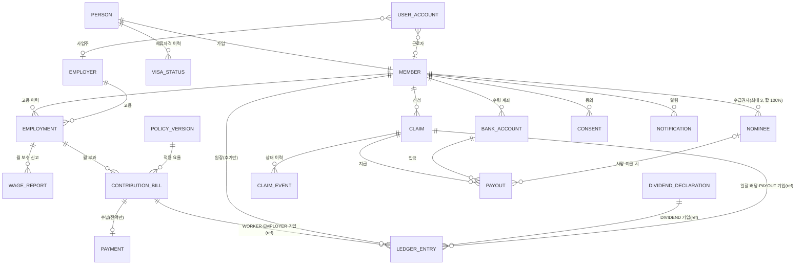

# ERD — 실제 구현 기준 (src/domain/types.ts, fixtures/demo.json)

설계서 §5.1 ERD의 18개 엔티티를 모두 구현했다. 아래 그림은 코드에 있는 그대로다. 설계서와 다른 점은 맨 아래 표에 적었다.

## 시연 데이터 행 수(기준일 2026-10-15)
| 엔티티 | 행 | 비고 |
|---|---|---|
| PERSON · MEMBER · VISA_STATUS | 5 · 5 · 5 | W005(베트남)는 국민연금 대상이라 공제회 부과·원장 없음(BR-23) |
| EMPLOYER · EMPLOYMENT | 2 · 6 | Aung은 고용 2건(사업장 이동, 공백 1개월) |
| WAGE_REPORT · CONTRIBUTION_BILL | 195 · 176 | 최저임금 인상률 반영 월 보수. 보수 신고 19건은 W005(부과 없음) |
| PAYMENT | 175 | Aung 2026-09분 1건 미납(BILL status OVERDUE) |
| LEDGER_ENTRY | 약 360 | 수납된 BILL마다 2건 + 연 배당 |
| DIVIDEND_DECLARATION · POLICY_VERSION | 6 · 1 | 배당은 시연용 가정 3%. 버전은 현행 제안 요율 하나 |
| BANK_ACCOUNT · NOMINEE · CONSENT · NOTIFICATION · USER_ACCOUNT | 4 · 2 · 8 · 9 · 6 | |
| CLAIM · CLAIM_EVENT · PAYOUT | 0 | 앱에서 신청·처리하면 생긴다 |

## 지키는 규칙(테스트로 검증, tests/rules)
- 잔액 = LEDGER_ENTRY 합계. 수납액 합 = 원장의 WORKER+EMPLOYER 합
- BILL → PAYMENT → LEDGER 순서. 미납 BILL은 원장에 없다
- 모든 BILL의 policy_version_id는 POLICY_VERSION에 있다
- CLAIM 전이는 전이표로만, 모든 전이는 CLAIM_EVENT. PAID면 일할 배당 → PAYOUT(음수) → 잔액 0 → MEMBER CLOSED

## 설계서 §5.1과 다른 점
| 항목 | 구현 | 이유 |
|---|---|---|
| EMPLOYER.name_latin 추가 | 영문 상호 | 비한국어 화면에 한글이 나오지 않게(P10) |
| CONTRIBUTION_BILL.wage_krw 추가 | 부과 당시 보수 | 고지서·내역 표시에 WAGE_REPORT 조인 없이 사용 |
| CLAIM.created_at·reject_reason | 추가 | 신청일 표시, 반려 사유 코드(§6.2) |
| BILL–PAYMENT 1:0..1 | 설계서는 1:N | 부분 납부는 범위 밖(§5.2-7) |
| POLICY_VERSION.params | 근로자 요율·사업주 단계만 | 부과 계산에 쓰는 값만 버전 관리. 나머지 제도 수치는 policy/*.json |
| DEATH·CONVERSION 신청 | 타입·전이표만 | 화면은 이번 범위 밖(§6.2) |
| USER_ACCOUNT | 앱 가입(모의): 외국인등록번호 앞 7자리로 PERSON.rid_masked와 맞춰 MEMBER를 찾고, 이 기기에 계정·간편 비밀번호를 둔다(브라우저 저장소 `gongjehoe.device`) | 실제 본인인증·기기 등록·비밀번호 서버 저장은 실서비스 단계(§13) |
