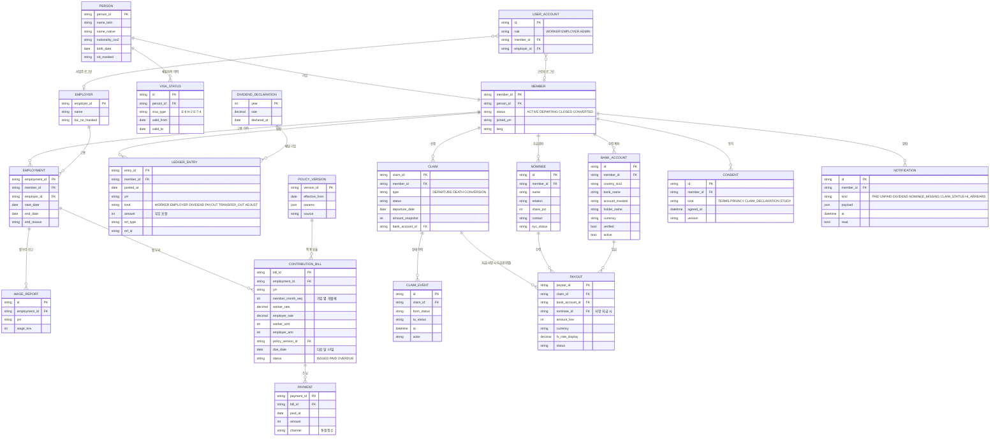

# 일하는 외국인 공제회 앱 — 시스템 설계서 v2.0

작성 2026-10-28 · 작성 이성옥(코드데이원 연구소) · 대상: Claude Code(구현), 코드데이원 개발팀(인수)
이 문서 하나로 설계부터 배포까지 진행한다. 구현자는 중간에 질문하지 않고 §14의 판단 규칙에 따라 끝까지 간다.

---

## 0. 이 문서를 쓰는 이유

v0.5 데모(`index.html` 단일 파일)는 시연용으로는 동작한다. 그러나 화면을 먼저 만들고 필요한 것을 그때그때 붙여서 시스템의 뼈대가 없다. v2는 순서를 바로잡는다.

**요구사항 → 업무 규칙 → 도메인 모델(ERD) → 상태 전이 → 정보 구조 → 화면 → 디자인 시스템 → 구현 → 검증 → 배포**

v2의 목표는 세 가지다.
1. 사용성 테스트(외국인 5~6명)와 논문(#9 설계·평가 논문)에 쓸 수 있는 완성도
2. 개발팀이 "고칠 필요 없이" 백엔드만 붙이면 되는 구조
3. 제도 수치가 코드에 흩어지지 않고 근거와 함께 한곳에서 관리되는 구조

범위 밖: 실제 백엔드, 실제 본인인증, 실제 송금. 모두 모의(mock) 계층으로 둔다.

---

## 1. 현행 v0.5 평가

### 1.1 설계 순서 문제
| 표준 순서 | v0.5에서 실제로 한 순서 | 결과 |
|---|---|---|
| 요구사항·업무규칙 정의 | 화면설계서(목업용)부터 작성 | 규칙이 화면 문구 속에 흩어짐 |
| 도메인 모델·ERD | 아키텍처 문서 §3에 7개 테이블 스케치만 있음 | 화면 코드가 이 모델을 쓰지 않음 |
| 상태 전이 정의 | 없음 | 환급 신청이 `step:1~4` 화면 번호로만 존재 |
| 화면 | 13종 구현 | 기능은 많은데 서로 연결이 약함 |
| 데이터 분리 | 로드맵 Lv3로 미룸 | 데이터·문구·로직·HTML이 한 파일에 섞임 |

### 1.2 데이터 모델 문제 (가장 심각)
1. **잔액이 원장에서 나오지 않는다.** `account()`가 `월급 × 요율 × 개월 수`로 매번 다시 계산한다. 원장(입금 기록)의 합이 아니다. 아키텍처 문서의 "원장=추가만 가능한 기입" 원칙과 코드가 다르다.
2. **월급이 고정값이다.** 근로자마다 `wage` 하나뿐이다. 실제로는 매달 보수월액이 바뀐다.
3. **사업장 변경이 없다.** E-9는 사업장을 옮길 수 있는데 `employment` 개념이 코드에 없다. 사업주 기여 요율 단계를 무엇 기준으로 셀지(가입 개월 수인지 사업장별 근속인지)도 정의되지 않았다.
4. **운용수익이 매달 복리로 붙는다.** 화면설계서는 EPF처럼 "연 1회 확정 배당"을 하자고 했는데 코드는 연 3% 가정을 매달 실제 잔액처럼 보여준다. 가정치가 확정 금액처럼 보이는 문제다.
5. **신청에 상태가 없다.** 접수·출국확인·지급·반려·취소 상태와 이력이 없다.
6. **ERD 스케치의 빈 곳.** 납부(고지·수납), 제도 파라미터 버전, 지급(통화·환율), 계좌, 동의, 알림, 감사 로그가 없다. `entry`에 사업장 참조가 없다. `nominee`에 지분 비율이 없다.

### 1.3 다국어 문제
자동 점검 결과 영어·베트남어·네팔어·인니어 모드에서 **한국어 문장이 화면별로 69개 남아 있다**(근로자 7개 화면, 3명 기준). 홈의 장기요양 안내·시뮬레이터 비교·환급 신청 단계·전환 미리보기·수급권자 지정 화면이 거의 한국어 그대로다. 문구가 HTML 템플릿 안에 직접 박혀 있어서 생긴 문제다.

### 1.4 화면·디자인 문제
1. 데모 조작 막대(근로자 선택·언어·역할 버튼)가 앱 화면 위쪽 약 120px을 차지한다. 사용성 테스트 참여자에게는 앱 일부로 보인다.
2. 하단 탭 바가 화면 하단에 고정되지 않고 본문 중간에 떠서 카드를 가린다.
3. 네팔어 화면에서 데바나가리 글꼴이 지정되지 않아 줄 높이와 굵기가 들쭉날쭉하다.
4. 도장 이미지에 `9月`처럼 한자가 섞여 있다.
5. 카드마다 여백·글자 크기·강조색이 조금씩 달라 통일감이 없다. 디자인 토큰이 화면설계서(녹색 #0F5132)와 실제 코드(KRDS 파랑)가 서로 다르다.

### 1.5 유지할 것
- 핵심 계산 개념(본인 4%·사업주 2→3→4%·만기 58개월)과 4명의 시연 인물
- "보장 지도"(지금 지키는 것 / 떠날 때 받는 것 / 비어 있는 자리) — 다른 앱에 없는 강점
- 사업주 화면의 "총무 추가 입력 0" 메시지와 국민연금 대비 비용 비교
- 팩트 규율(검증 안 된 수치 금지, 제안 항목 라벨)

---

## 2. 벤치마킹 — 공개 자료로 확인한 사실만

계정이 없어 실제 로그인은 하지 않았다. 아래는 공식 사이트·공식 사용자 매뉴얼·앱스토어 공개 정보로 확인한 내용이다.

### 2.1 말레이시아 EPF「KWSP i-Akaun」
- 하단 탭 4개: Home · Savings · Withdrawal · Profile (스토어 공식 홍보 이미지)
- 홈: 원형 차트로 총 저축액과 기준일 표시, "Show Amount"로 금액 가리기/보이기
- 기능: 잔액·납입 내역, 명세서 다운로드, 인출 신청과 진행 조회, 수급권자 지정, 자발적 추가 납입, 은퇴 목표 계산기, 생체 로그인, 거래 승인(i-Akaun Secure)
- 신청 취소는 상태가 "Submitted"일 때만 가능
- 외국인: 앱에서 가입·활성화와 Akaun Fleksibel(부분 인출) 신청 가능(스토어 설명). 외국인 기여금이 어느 계좌로 나뉘는지는 확인 못 함 [확인필요]
- 위 스토어·매뉴얼 내용은 2026-10-28 확인
- **출국 인출(Leaving Country Withdrawal)은 앱으로 신청할 수 없다.** 지점 방문 또는 우편이다. 여권 사본, 패널은행 계좌 증빙, 노동허가, 출입국 체크아웃 메모 등이 필요하고 사본은 모두 공증을 받아야 한다. 해외 수령은 외화 송금수표다.
- i-Akaun Secure 승인 흐름: 인증 방법 선택 → 앱 승인 → 요약 확인 → "Approve" → 처리 중 화면. 승인 제한 시간 60초, 3번 만료되면 시도 제한
- 지원 언어: 영어·말레이어 2개뿐(App Store)
- Google Play 평점 4.3(약 6.4만 건), 다운로드 1천만 이상. 스토어에 보이는 최근 리뷰(2026년 7~9월) 3건은 모두 **로그인 실패** 불만이다
- 외국인 의무 가입(2025.10 임금분부터 노사 각 2%)은 기존 화면설계서에서 kwsp.gov.my로 확인한 내용이다. 이번 조사에서는 해당 페이지 접속이 막혀 2차 기사로만 다시 확인했다

### 2.2 한국「EPS 전용보험」(삼성화재)
- 외국인 근로자 전용보험(출국만기·상해·귀국비용·임금체불보증) 청구와 진행 조회, 예상 수령액 조회
- 19개 언어 지원(스토어 설명)
- 리뷰 불만: 외국인등록번호 뒷자리·여권번호 입력이 안 돼 가입 실패, 공동인증서 특수문자 입력 불가
- 마지막 업데이트 2023-11

### 2.3 한국「내 곁에 국민연금」(국민연금공단)
- App Store 평점 1.9(634건). 불만은 로그인·인증 실패, 계좌 변경 시 숫자 키패드에서 하이픈 입력 불가
- 접근성 기능 미등록

### 2.4 설계에 반영할 교훈
| 교훈 | 반영 |
|---|---|
| 세 앱 모두 가장 큰 불만은 로그인·인증 | 데모는 인물 선택으로 입장. 실서비스 설계에는 외국인등록번호 입력 형식 자유화(하이픈·공백 허용) 명시 |
| EPF는 출국 인출을 앱으로 못 한다 | 우리 핵심 차별점. 환급 신청을 앱 안에서 끝내는 흐름(§8 W-31) |
| EPF는 2개 언어 | 우리는 5개 언어로 시작해 송출국 언어로 확장 |
| EPF 탭 4개 구조는 검증된 패턴 | 홈·내역·받기·내 정보 4탭 |
| 승인 60초 제한은 저문해 사용자에게 압박 | 제한 시간을 두지 않거나 넉넉히(§10.2) |
| 숫자 입력 실패가 흔함 | 금액·날짜 입력을 선택형으로 대체 |

### 2.5 저문해 사용자 금융 UI 원칙 (MicroSave, Matthews & Kushwaha 2017)
그림으로 뜻이 드러나는 아이콘, 화면당 정보 최소화, 잔액을 실감 나게 표시, 단계마다 무엇이 일어나는지 보여주기, 시간 제한 같은 압박 피하기, 숫자 직접 입력 줄이기. v2는 이 원칙을 §10에 그대로 반영한다.

---

## 3. 요구사항

### 3.1 액터
| 액터 | 설명 | 채널 |
|---|---|---|
| 근로자(Member) | E-9·H-2 외국인 근로자. 한국어가 서툴 수 있음 | 모바일 웹앱(PWA) |
| 수급권자(Nominee) | 본국 가족. 앱을 쓰지 않음 | 없음(근로자가 등록) |
| 사업주(Employer) | 외국인을 고용한 중소기업 담당자 | 데스크톱 웹 |
| 운영자(Admin) | 공제회 운영기관 직원 | 데스크톱 웹 |
| 외부 기관 | 건보공단(통합징수)·법무부(출입국)·고용부(EPS)·국민연금공단·은행 | 모의 어댑터 |

### 3.2 유스케이스
| ID | 액터 | 유스케이스 | 우선 |
|---|---|---|---|
| UC-01 | 근로자 | 언어를 고르고 입장한다 | 필수 |
| UC-02 | 근로자 | 총 적립액과 구성(내 돈·사업주 돈·운용수익)을 본다 | 필수 |
| UC-03 | 근로자 | 이번 달 납입이 됐는지 확인한다 | 필수 |
| UC-04 | 근로자 | 월별 내역을 보고 명세서를 받는다 | 필수 |
| UC-05 | 근로자 | 지금 귀국하면/만기까지 있으면 얼마인지 본다 | 필수 |
| UC-06 | 근로자 | 출국 환급을 신청한다 | 필수 |
| UC-07 | 근로자 | 신청 진행 상황을 보고 접수 상태면 취소한다 | 필수 |
| UC-08 | 근로자 | 수급권자(가족)를 지정한다 | 필수 |
| UC-09 | 근로자 | 내 보장 지도(4대보험·전용보험·공제회)를 본다 | 필수 |
| UC-10 | 근로자 | 장기 체류 전환(E-7-4) 시 국민연금 이체를 미리 본다 | 권장 |
| UC-11 | 근로자 | 받을 계좌를 등록·변경한다 | 필수 |
| UC-12 | 사업주 | 근로자별 기여 현황과 이번 달 납부액을 본다 | 필수 |
| UC-13 | 사업주 | 국민연금 대비 비용을 비교한다 | 필수 |
| UC-14 | 사업주 | 신규 채용 시 자동 가입 결과를 확인한다 | 권장 |
| UC-15 | 운영자 | 기금 현황(가입자·적립·환급)을 본다 | 필수 |
| UC-16 | 운영자 | 환급 신청을 심사·지급 처리한다 | 권장 |
| UC-17 | 운영자 | 재정 시뮬레이션(몬테카를로)을 돌린다 | 선택 |

### 3.3 비기능 요구사항
| ID | 요구 | 기준 |
|---|---|---|
| NFR-01 | 접근성 | WCAG 2.2 AA. axe 자동 검사 위반 0건(5개 언어 × 전 화면) |
| NFR-02 | 다국어 | 모든 화면 문구가 번역 파일에서 나옴. 키 누락 0건이어야 빌드 통과 |
| NFR-03 | 성능 | 중저가 안드로이드 기준 첫 화면 2초 이내. Lighthouse 성능 90 이상 |
| NFR-04 | 오프라인 | 한 번 연 화면은 오프라인에서도 열림(PWA 캐시) |
| NFR-05 | 개인정보 | 데모 데이터만 사용. 등록번호는 항상 마스킹 |
| NFR-06 | 팩트 | 화면의 모든 제도 수치는 `policy` 파일에서만 읽음. 근거 없는 수치 금지 |
| NFR-07 | 정확성 | 계산 엔진 단위 테스트 100% 통과(§6.4) |
| NFR-08 | 터치 | 터치 영역 최소 48×48px |

---

## 4. 업무 규칙 (Business Rules)

라벨: **[법령]** 현행 법령 · **[제안]** 정책제안서 설계값 · **[가정]** 시뮬레이션 가정 · **[결정]** 이 설계서의 결정 · **[확인필요]** 구현 전 재검증

| ID | 규칙 | 라벨·근거 |
|---|---|---|
| BR-01 | 근로자 기여율 = 보수월액의 4% | [제안] 이성옥·김태희(2025) |
| BR-02 | 사업주 기여율 = 가입 1~24개월 2%, 25~48개월 3%, 49개월~ 4% | [제안] |
| BR-03 | 요율 단계는 **공제회 가입 누적 개월 수** 기준(사업장을 옮겨도 이어짐). `member_month_seq` = 부과(BILL)가 생긴 서로 다른 년월의 수(공백 달 제외). 같은 달에 고용이 둘이면 seq 1개, BILL 2장 | [결정] 사업장 변경 시 근로자 불이익 방지. 정책제안서와 대조 [확인필요] |
| BR-04 | 만기 = 58개월(최초 3년 + 재고용 연장). 만기 후에도 재고용 중이면 적립 계속, 사업주 요율 4% 유지 | [법령] 외국인고용법 제18조(3년)·제18조의2(2년 미만 연장). 1년 10개월은 실무 관행 |
| BR-05 | 운용수익은 **연 1회 확정 배당**으로 원장에 기입. 확정 전에는 잔액에 넣지 않음. 공제회는 아직 없는 제도라 과거 배당률도 시연용 가정값(연 3%, `demo_dividend`)이며 화면에 "시연용 가정 배당"으로 표시 | [결정]+[가정] |
| BR-06 | 시뮬레이션의 미래 수익률 = 연 3% | [가정] 화면에 "예시" 표시 필수 |
| BR-07 | 출국 환급액 = 지급(PAID) 시점의 원장 잔액 전부. 지급 직전에 직전 선언률로 그해 일할 배당을 기입(DIVIDEND, ref=claim)해 연중 출국자도 수익을 받음. 신청 시 금액(snapshot)은 표시용 | [제안]+[결정] |
| BR-08 | 환급 지급 목표 = 출국 확인 후 3영업일 | [제안] 화면에 "목표" 표시 |
| BR-09 | 환급 신청은 출국 예정일 기준 30일 전부터 가능 | [결정] [확인필요] |
| BR-10 | 신청 취소는 '접수' 상태에서만 가능 | [결정] EPF 규칙 차용 |
| BR-11 | 수급권자 지분 합계 = 100%. 최대 3명. 지분 칩 100·50·34·33, "균등 배분"은 나머지를 첫 사람에게 | [결정] |
| BR-12 | 환급·계좌 변경·수급권자 지정은 추가 승인(보안 확인) 필요 | [결정] EPF i-Akaun Secure 패턴 |
| BR-13 | E-7-4 전환 시 공제회 적립액과 가입 개월 수를 국민연금으로 이체·합산 | [제안] 입법 필요 사항. "(제안)" 라벨 필수 |
| BR-14 | 출국만기보험(사업주, 월 통상임금의 8.3%)은 공제회와 별도로 유지 | [법령] 외국인고용법 제13조·시행령·고용노동부 고시. 고시 번호 확인 [확인필요] |
| BR-15 | 국민연금 사용자 부담률 비교값: 2026년 4.75% → 2033년 6.5%(매년 0.25%p) | [법령] 2025년 개정 국민연금법(보험료율 9%→13%) |
| BR-16 | 국민연금 반환일시금 비교는 "약식 예시"로만 표시(원금 + 이자 2.2%) | [가정] 2.2% 근거 출처 재확인 [확인필요] |
| BR-17 | 국적별 국민연금 당연적용 여부는 `policy/nps_countries.json`에서 읽음. 적용 대상이면 E-8·E-9·H-2는 국적과 무관하게 출국 시 반환일시금 대상(국민연금법 제126조) | [법령] 국민연금공단 「외국 연금제도 조사 내용」(2025.2.1)을 1차 기준으로. **베트남은 자료 간 충돌**(2025 조사 자료는 '22.1.1 이후 당연적용, 이전 외국인 안내서는 제외) → 최신 1차 자료로 확정 [확인필요]. 네팔·인니·중국 행도 같은 자료로 재확인 |
| BR-18 | 장기요양보험은 외국인 근로자가 신청하면 제외 가능 | [법령] 노인장기요양보험법령 |
| BR-19 | 금액은 원화 정수(원 단위)로 저장. 외화는 표시용 환산만 | [결정] |
| BR-20 | 검토 단계 항목(정부 매칭·세액공제·추가 적립)은 "(검토 중)" 라벨 | [결정] 기존 팩트 규율 |
| BR-21 | 공제회 기여는 4대보험 통합징수로 함께 고지·수납. 납부 기한은 다음 달 10일 | [제안] 통합징수 납기 준용 [확인필요] |
| BR-22 | 모든 날짜 계산의 기준일은 `policy/demo.json`의 `today: 2026-10-15`, `latest_paid_ym: 2026-09`. 코드에서 `Date.now()`·`new Date()` 직접 사용 금지(시계 모듈 하나로만) | [결정] 시연·테스트 재현성 |

---

## 5. 도메인 모델과 ERD

### 5.1 ERD



### 5.2 모델 원칙
1. **잔액 = 원장 합계.** 화면의 어떤 금액도 원장 밖에서 계산하지 않는다. 시뮬레이션만 예외이며 `projection` 모듈에서 따로 계산하고 "예시" 라벨을 붙인다.
2. **원장은 추가만 한다.** 수정은 반대 부호의 `ADJUST` 기입으로 한다.
3. **부과와 수납을 나눈다.** 고지(BILL) → 수납(PAYMENT) → 원장 기입(LEDGER) 순서. 미납이면 원장에 들어가지 않는다. 홈의 "이번 달 납입 확인"은 PAYMENT 존재 여부로 판단한다.
4. **요율은 버전으로 관리한다.** BILL마다 어느 `POLICY_VERSION`으로 계산했는지 남긴다.
5. **보장 지도는 저장하지 않고 계산한다.** 국적·비자·가입 상태를 규칙표(`policy/coverage.json`)에 넣어 결과를 만든다.
6. 감사 로그·기기 등록·실제 인증은 실서비스 단계 항목으로 설계 문서에만 남긴다(§13).
7. 부분 납부는 이번 범위에서 다루지 않는다. BILL은 전액 납부(PAID) 또는 미납(OVERDUE)만 있다.
8. 건강보험 미납(Siti)은 공제회 데이터가 아니다. 외부 기관 연계를 전제로 한 `HI_ARREARS` 알림 fixture로만 만들고 "건보공단 정보, 공제회 소관 아님"을 표시한다.

### 5.3 시연 데이터(fixtures)
기존 4명을 유지하되 원장 방식으로 다시 만든다. 생성 스크립트가 고용 이력과 월 보수로 BILL·PAYMENT·LEDGER를 만든다. 손으로 쓴 총액을 넣지 않는다.

| 인물 | 국적·언어 | 비자 | 가입 개월(2026-09 기준) | 특징 |
|---|---|---|---|---|
| Ramesh Gurung | 네팔·ne | E-9 | 36 | 기본 시나리오. 사업장 1곳 |
| Nguyen Van An | 베트남·vi | E-9 | 18 | 13개월째 사업장 변경(1개월 공백) — 요율 연속성 시연 |
| Siti Rahma | 인도네시아·id | E-9 | 52 | 건보 미납 30만 원 알림. 만기 임박 |
| 김해란 | 중국(동포)·ko | H-2 | 70 | 만기 초과·장기 체류 전환 시연 |

월 보수는 매년 최저임금 인상분만큼 오르게 생성한다. 실제 최저임금 고시액을 `policy/min_wage.json`에 출처와 함께 넣는다. 확인되지 않으면 기존 고정 월급을 쓴다.

---

## 6. 상태 전이와 계산 엔진

### 6.1 가입 상태(MEMBER.status)
```
ACTIVE(적립 중) ──출국 환급 신청──▶ DEPARTING(출국 준비) ──지급 완료──▶ CLOSED
   │                                   │
   │                          신청 취소(접수 상태만)
   │                                   ▼
   │                                ACTIVE
   └──E-7-4 전환──▶ CONVERTED(국민연금 이체 완료)
```

### 6.2 신청 상태(CLAIM.status)
```
DRAFT ─제출─▶ SUBMITTED(접수) ─출국 확인(출입국 모의)─▶ VERIFIED ─승인─▶ PAYING ─입금─▶ PAID
                 │                                         │
                 └─근로자 취소─▶ CANCELLED                   └─반려─▶ REJECTED(사유 코드)
```
모든 전이는 CLAIM_EVENT에 남기고 근로자 화면에 타임라인으로 보여준다.

**두 상태의 연결**
- CLAIM이 SUBMITTED가 되면 MEMBER는 DEPARTING
- CLAIM이 CANCELLED 또는 REJECTED가 되면 MEMBER는 ACTIVE로 복귀
- CLAIM이 PAID가 되면 일할 배당 기입(BR-07) → PAYOUT 음수 기입 → 잔액 0 → MEMBER는 CLOSED
- CLAIM type 중 DEATH·CONVERSION은 타입과 전이표만 정의하고 이번 범위에서는 화면을 구현하지 않는다(W-33은 미리보기만)

### 6.3 계산 모듈 (`src/domain/`)
순수 함수만 둔다. 화면 코드와 완전히 분리한다.
- `billFor(employment, wage, memberMonthSeq, policy)` → 근로자·사업주 금액
- `balance(entries)` → `{worker, employer, dividend, total}`
- `declareDividend(entries, year, rate)` → 배당 기입 목록(연 평균 잔액 기준)
- `project(member, untilMonth, policy, assumedRate)` → 미래 잔액 예시
- `npsLumpSumEstimate(member, policy)` → 반환일시금 약식 비교값(적용국만)
- `coverageMap(member, policy)` → 보장 지도 3그룹
- `claimTransition(claim, action, actor)` → 다음 상태 또는 오류

### 6.4 규칙 엔진 테스트 (논문 평가에 그대로 씀)
`tests/rules/`에 업무 규칙마다 테스트를 만든다. 최소 기준:
- BR-01·02·03: 경계값(24·25·48·49개월), 사업장 변경 공백, 월급 변동
- BR-04: 58개월 만기 경계
- BR-05·07: 배당 확정 전후 잔액
- BR-10: 상태별 취소 가능 여부
- BR-11: 지분 합 99·100·101%
- BR-17: 국가별 국민연금 적용 여부 전체 표
- BR-04: 만기 초과(70개월) 적립 계속
- BR-07: 연중 출국 시 일할 배당
- BR-09·12·19·22, MEMBER·CLAIM 상태 전이 전부
- 4명 시연 인물의 총액 스냅숏. 기대값은 P4에서 처음 생성한 값을 고정한다. 기존 화면설계서 값(예: Ramesh 5,723,627원은 월복리 방식)과 다르면 차이와 이유를 README에 적는다

"통과 기준"은 작성한 테스트 전부 통과를 뜻한다.

테스트 결과를 `reports/rules.json`(통과 수·실패 수·규칙별 사례 수)으로 내보낸다.

---

## 7. 시스템 구조 (프로토타입)

### 7.1 기술 선택
| 영역 | 선택 | 이유 |
|---|---|---|
| 빌드 | Vite + TypeScript | 정적 파일로 나와 GitHub Pages에 그대로 배포 |
| UI | React 18 | 개발팀 인수가 쉬움. 아키텍처 문서의 React 웹 계획과 일치 |
| 라우팅 | React Router(해시 라우터) | Pages에서 새로고침해도 깨지지 않음 |
| 다국어 | i18next + `locales/{lang}.json` | 기존 STR 키 체계 이어받기 |
| 상태 | 화면 상태는 React, 업무 데이터는 저장소 계층 | 백엔드 교체 지점을 한 곳으로 |
| 데이터 | `src/data/` 저장소 인터페이스 + `MockRepository`(fixtures JSON) | 나중에 `HttpRepository`로 바꾸면 끝 |
| 데모 데이터 유지 | fixtures를 초기값으로, 변경분(신청·수급권자·계좌)은 localStorage에 저장(읽기·쓰기 모두 try/catch, 실패 시 메모리). 데모 런처에 "시연 초기화" 버튼. E2E는 매 테스트 전 초기화 | W-31에서 낸 신청이 W-32·A-20에 함께 보이게 |
| 테스트 | Vitest(도메인), Playwright(E2E·스크린샷), @axe-core/playwright(접근성), @lhci/cli(Lighthouse 모바일 기본 에뮬레이션) | 논문 평가 지표 자동 산출 |
| 아이콘·글꼴 | lucide-react, 글꼴은 저장소에 넣어 직접 제공(PWA 캐시) | 외부 CDN 의존 없음 |
| PWA | vite-plugin-pwa | 홈 화면 추가, 오프라인 |
| 배포 | GitHub Actions → GitHub Pages | main에 올리면 자동 배포 |

### 7.2 폴더 구조
```
/
├─ CLAUDE.md                  # Claude Code 실행 지침(§14 요약)
├─ docs/설계서_v2.md            # 이 문서
├─ policy/                    # 제도 수치(근거 포함) — 코드에 숫자 금지
│   ├─ params.json            # 요율·만기·가정 수익률, 각 값에 source·label
│   ├─ nps_countries.json     # 국가별 국민연금 적용·반환일시금
│   ├─ coverage.json          # 보장 지도 규칙
│   └─ min_wage.json
├─ fixtures/                  # 생성 스크립트 결과(직접 수정 금지)
├─ scripts/gen-fixtures.ts
├─ locales/{ko,en,vi,ne,id}.json
├─ src/
│   ├─ domain/                # 순수 계산·상태 전이
│   ├─ data/                  # Repository 인터페이스·Mock 구현
│   ├─ ui/                    # 디자인 시스템 컴포넌트
│   ├─ apps/worker/           # 근로자 앱(모바일)
│   ├─ apps/employer/         # 사업주 포털
│   ├─ apps/admin/            # 운영자
│   └─ demo/                  # 데모 런처(앱 밖)
├─ tests/{rules,e2e,a11y}/
└─ reports/                   # 자동 생성 평가 결과
```

### 7.3 데모 런처와 앱 분리
- `#/` 데모 런처: 인물 4명, 사업주, 운영자 카드. 연구 소개와 "시연 데이터" 안내.
- `#/w/:memberId/...` 근로자 앱: 데모 조작 막대 없음. 화면 모서리의 작은 "데모" 칩으로만 런처 복귀.
- `?study=1`이면 "데모" 칩도 숨김(사용성 테스트용).
- `#/e/...` 사업주, `#/a/...` 운영자.

---

## 8. 정보 구조(IA)와 화면 명세

### 8.1 근로자 앱 — 하단 탭 4개 (EPF 구조 차용)
| 탭 | 아이콘 | 포함 화면 |
|---|---|---|
| 홈 | 집 | W-10 홈 |
| 내역 | 목록 | W-20 원장 내역, W-21 명세서 |
| 받기 | 손에 든 돈 | W-30 귀국 시 받는 돈(시뮬레이터), W-31 환급 신청, W-32 신청 현황, W-33 장기 체류 전환 |
| 내 정보 | 사람 | W-40 내 정보, W-41 수급권자, W-42 수령 계좌, W-43 보장 지도, W-44 언어, W-45 도움말 |

공통: 하단 탭은 항상 화면 바닥에 고정(safe-area 반영). 본문은 탭 높이만큼 아래 여백. 하위 화면은 상단에 뒤로 가기와 제목. 상단 바 오른쪽에 언어 변경(지구본) 아이콘을 항상 둔다. 금액은 기본으로 보이고 가리기는 선택.

### 8.2 화면 명세
각 화면은 **목적 / 데이터 / 행동 / 상태(로딩·비어 있음·오류)**를 구현한다.

**W-01 언어 선택(첫 실행)**
- 목적: 10초 안에 자기 언어로 진입
- 구성: 서비스명, 한 줄 약속 문구, 언어 5개(원어 표기, 국기 금지), 시작 버튼
- 이후 언어는 W-44에서 언제든 변경

**W-02~06 앱 가입·로그인(변경 2026-10-29, 사용자 요청: "회원가입이 없고 바로 이름부터 들어간다")**
- 공제회 가입은 고용 때 자동(E-40)이므로 앱에서는 "앱 가입"(계정 연결)만 한다
- W-02 가입·로그인 고르기 → W-03 본인 확인(외국인등록번호 **앞 7자리**만 + 휴대폰 번호 → 인증번호, 하이픈·띄어쓰기 허용 — §2 경쟁 앱 불만 대응) → W-04 내 계좌 확인·필수 동의 2개(가입일 때만) → W-05 간편 비밀번호 6자리(같은 숫자·연속 숫자 거절, 두 번 확인) → 홈
- W-06 다시 열 때: 로그인 상태면 바로 홈, 로그아웃 뒤에는 간편 비밀번호(잊었으면 본인 확인부터, 다른 계정 가능)
- 전체 외국인등록번호는 받지 않는다(§15). 시연 인증번호는 화면에 표시, 실제 문자 인증·얼굴 대조는 §13
- 이전 데모의 "인물 고르기 로그인"은 `#/demo` 런처로만 남긴다

**W-10 홈**
- 위→아래: 인사·기준일 / 총 적립액 카드(큰 숫자, 금액 가리기 버튼, 원형 진행: 가입 개월/58) / 구성 3칸(내 돈·사업주 돈·확정 운용수익) / 이번 달 납입 상태 / 알림 카드(건보 미납, 수급권자 미지정, 배당 확정 등 최대 2개) / 바로가기 2개(귀국하면 얼마?, 보장 지도)
- 납입 상태: 납입 확인(녹색), 확인 전(회색), 미납(빨강, 사업주 문의 안내)
- "사업주 돈도 내 돈" 메시지를 구성 카드 설명에 한 줄로

**W-20 내역**
- 월 단위 목록: 년월, 내 돈, 사업주 돈, 누적. 배당 행·요율 변경 구분선·사업장 변경 구분선
- 필터: 전체/납입/배당. 상단에 누적 잔액 작은 그래프
- 비어 있음: "첫 납입은 납부 기한이 지나면 표시됩니다"

**W-21 명세서**: 연도 선택 → PDF 모의 다운로드(인쇄용 HTML)

**W-30 귀국 시 받는 돈**
- 슬라이더 대신 **선택형 칩**: 지금 / 6개월 뒤 / 1년 뒤 / 만기(58개월). 숫자 입력 없음
- 결과: 확정 잔액 + 예상 추가분(빗금 표시, "예시" 라벨)
- 비교: 현행 국민연금 반환일시금(적용국만) — 막대 2개. 비적용국은 "현행 제도에서는 받을 노후 적립이 없음" 문장
- 고지: 가정 수익률과 약식 산정 설명(접기)

**W-31 환급 신청** (EPF가 앱으로 못 하는 흐름)
1. 출국 예정일: 칩(2주 뒤·한 달 뒤) + "직접 고르기"(달력). 선택 범위는 기준일~기준일+30일(BR-09). 키보드 입력 없음
2. 받을 계좌: 등록된 계좌 카드 선택 또는 추가(W-42)
3. 확인: 금액·계좌·예정일 요약, 동의 체크 1개
4. 보안 확인: 바텀시트 "본인이 맞나요?" → 확인(생체인증 모의). **시간 제한 없음**
5. 접수 완료: 다음에 일어날 일 3줄(출국 확인 → 승인 → 입금, 목표 3영업일). "3영업일"은 문구로만 표시하고 공휴일 계산은 하지 않는다
- 서류 업로드 없음. 이유를 한 줄로("공제회가 출국 기록을 직접 확인합니다")

**W-32 신청 현황**: 상태 타임라인(§6.2). 접수 상태면 "신청 취소" 버튼. 데모 전용 "다음 단계로" 버튼(데모 칩 메뉴 안)

**W-33 장기 체류 전환 미리보기**: 두 갈래 그림(귀국 → 전액 환급 / 전환 → 국민연금 이체·기간 합산). 상단에 "(제안) 법 개정이 필요한 내용입니다"

**W-40 내 정보**: 이름·국적·비자·가입일·사업장, 하위 메뉴 목록

**W-41 수급권자**: 목록 + 추가. 이름·관계(선택형)·지분(칩: 100/50/33…)·연락처. 합계 100% 검증. 저장 시 보안 확인. 신분증 촬영은 "실서비스에서 진행" 안내만

**W-42 수령 계좌**: 국가 → 은행(목록 선택) → 계좌번호(공백·하이픈 허용, 자동 정리) → 예금주 확인. 저장 시 보안 확인

**W-43 보장 지도**: 3그룹 목록. 항목을 누르면 쉬운 설명·누가 내는지·어디에 신청하는지. 상태 뱃지(적용·선택 가입·제외·제안)는 색과 함께 글자로도 표시

**W-45 도움말**: 다국어 상담 전화 안내. 번호는 `policy`에 출처와 함께. 확인 안 된 번호는 넣지 않음. 국민연금 1355는 공단 외국인 안내서로 확인된 번호

**W-10 원형 진행 예외**: 58개월을 넘긴 경우(김해란) 원 전체를 채우고 "만기 지남 · 계속 적립 중" 표시

### 8.3 사업주 포털
- **E-10 대시보드**: KPI 3개(이번 달 납부·국민연금 대비 올해 차액·재직 인원). 차액은 **국민연금 적용국 근로자만** 계산한다. 비적용국 근로자 몫은 "신규 부담"으로 따로 보여준다(지금 국민연금을 안 내는 근로자라 절감이 아님), 비교 그래프('26~'33), 근로자 표(이름·비자·가입 개월·요율 단계·이번 달·누적), 알림 피드
- **E-20 근로자 상세**: 월별 부과·수납 내역
- **E-30 납부**: 통합징수 고지서 모양에 공제회 1행. "추가 신고 없음"
- **E-40 신규 채용 자동 가입**: 기존 시연 유지(외국인등록번호 마스킹 칩 선택)

### 8.4 운영자
- **A-10 기금 현황**: 가입자·적립 총액·이번 달 환급·전환 건수, 국적별 구성. 모든 화면에 "시연 데이터" 워터마크
- **A-20 환급 처리함**: 신청 목록과 상태 변경(근로자 W-32와 같은 데이터)
- **A-30 재정 시뮬레이터**: `docs/ref_fund-simulator.jsx` 이식. 선택 구현

---

## 9. 디자인 시스템

### 9.1 방향
"관공서 앱의 신뢰감 + 금융앱의 깔끔함". 기준은 KRDS(대한민국 정부 디자인 시스템, krds.go.kr)다. 녹색 토큰(#0F5132)은 폐기하고 KRDS 파랑 계열 하나로 통일한다. 정확한 색상 값은 구현 시 krds.go.kr의 공개 토큰을 확인해 `src/ui/tokens.css`에 옮기고 출처 주석을 단다. 확인 전에는 아래 임시값을 쓴다.

> **변경(2026-10-29):** 브랜드 색과 구성은 Figma 커뮤니티 iBank UI 키트(Seju, CC BY 4.0)로 바꿨다(PR #6). 상태 색(성공·주의·위험·정보)과 회색 글자는 대비 기준 때문에 KRDS 공식 토큰을 유지한다. 실제 값은 `src/ui/tokens.css`에 있다.

### 9.2 토큰(임시값 — KRDS 확인 후 교체)
| 토큰 | 값 | 용도 |
|---|---|---|
| `--color-primary` | #0B50D0 | 주요 버튼, 강조 숫자 |
| `--color-primary-weak` | #EAF1FD | 선택 배경 |
| `--color-text` | #1E2124 | 본문 |
| `--color-text-sub` | #464C53 | 보조(대비 7:1 이상 유지) |
| `--color-bg` | #F4F5F6 | 화면 배경 |
| `--color-surface` | #FFFFFF | 카드 |
| `--color-success` | #12805C | 납입 확인 |
| `--color-warning` | #9E6A00 | 주의(배경은 #FFF6E0) |
| `--color-danger` | #D02C2C | 미납·오류 |
| `--radius-card` | 16px | |
| `--radius-button` | 12px | |
| 간격 | 4·8·12·16·24·32 | 4px 단위만 사용 |

### 9.3 글꼴
- 한국어·라틴: Pretendard GOV(KRDS 권장) → 대체 Pretendard → system-ui
- 네팔어: Noto Sans Devanagari, 베트남어: 성조 지원 확인된 Pretendard/Noto Sans
- 글자 크기: 본문 17px, 보조 15px, 제목 20·24px, 총액 36px. 최소 14px
- 숫자: `font-variant-numeric: tabular-nums`
- 줄 높이: 라틴·한글 1.5, 데바나가리 1.7

### 9.4 컴포넌트 목록
AppBar, TabBar(하단 고정), Card, AmountDisplay(금액 가리기 포함), StatusBadge(색+글자), ListRow, Chip/ChipGroup, BottomSheet, Stepper, Timeline, Banner(정보·주의·오류), EmptyState, Skeleton, Toast, DataTable(데스크톱), KPI, LineChart·BarChart(SVG 직접)

모든 컴포넌트는 `src/ui/`에 두고 화면 코드에서 인라인 스타일 금지.

### 9.5 시각 규칙
- 화면당 주요 버튼 1개
- 아이콘은 하나의 세트(Lucide 등 선 아이콘)로 통일. 이모지·한자 도장 금지
- 금액 옆 "₩"는 작게, 숫자는 크게
- 그림자는 1단계만, 테두리 없이 면으로 구분
- 애니메이션은 200ms 이하, `prefers-reduced-motion` 존중

---

## 10. 다국어·접근성·저문해 원칙

### 10.1 다국어
- 모든 문구는 `locales/*.json`. 컴포넌트에 한글 직접 입력 금지(빌드 검사로 차단: `src/apps/**`에서 한글 정규식 검출 시 실패. 단 `src/demo`와 주석 제외)
- 키 누락 검사: ko를 기준으로 다른 언어의 키가 하나라도 없으면 빌드 실패
- 번역 원칙: 짧은 문장, 전문용어 대신 쉬운 말(예: "사업주 기여" → "회사가 넣어 준 돈"). 원어민 검수 전 번역에는 `"_review": "machine"` 표시를 파일 메타에 둔다
- 금액은 항상 원화. 본국 통화 환산은 W-30에서만 "약" 표시로
- 날짜: 2026.09.30 형식을 모든 언어 공통으로(혼동 방지). 숫자는 모든 언어에서 아라비아 숫자(데바나가리 숫자·네팔 비크람력 쓰지 않음)
- 듣기: 주요 화면 제목과 금액에 "듣기" 버튼(Web Speech API). 브라우저가 해당 언어 음성을 지원하지 않으면 버튼을 숨김
- 확장 예정: km, my, uz, th, bn — 키 구조만 준비

### 10.2 접근성·저문해
- 터치 영역 48px 이상, 대비 4.5:1 이상(본문)
- 상태를 색만으로 구분하지 않음
- 숫자 입력 최소화: 날짜는 달력, 금액은 칩, 계좌번호만 직접 입력
- 보안 확인에 시간 제한 없음(EPF 60초와 다르게)
- 각 신청 단계 상단에 "지금 하는 일" 한 줄과 진행 표시
- 되돌릴 수 없는 행동 전에는 요약 확인 화면
- 스크린리더: 금액은 "5,723,627원"으로 읽히게 aria-label
- 확대 200%에서 가로 스크롤 없음

---

## 11. 사용성 테스트와 논문 연결

### 11.1 과업(5~6명, 2회차 각 3명 권장)
| ID | 과업 | 성공 기준 |
|---|---|---|
| T1 | 내 언어로 바꾸고 총 적립액을 말하기 | 금액을 정확히 말함 |
| T2 | 이번 달 회사 돈이 들어왔는지 확인 | 납입 상태를 정확히 말함 |
| T3 | 1년 뒤 귀국하면 얼마인지 확인 | 해당 금액 도달 |
| T4 | 다음 달 출국으로 환급 신청 | 접수 완료 화면 도달 |
| T5 | 어머니를 수급권자로 지정 | 저장 완료 |

### 11.2 자동 기록(연구용)
- `?study=1`일 때만 화면 전환·클릭·소요 시간을 브라우저 안에 기록하고 종료 화면에서 JSON 내보내기. 서버 전송 없음. 이름·번호 저장 없음
- 동의서·과업 시나리오·참여자 정보표 양식은 `docs/usability/`에 둔다(별도 작업)

### 11.3 자동 평가 산출물(`reports/`)
- `rules.json`: 규칙 엔진 테스트 결과
- `a11y.json`: 언어 5개 × 화면별 axe 위반 수
- `i18n.json`: 언어별 키 수·누락 수·기계번역 표시 수
- `lighthouse/`: 근로자 홈·신청 화면 점수
- `klm.md`: T3·T4의 KLM 단계 수(EPF 공개 매뉴얼의 Akaun Fleksibel 인출 11단계, 출국 인출 지점 절차와 비교)

---

## 12. 팩트 규율

1. 제도 수치는 `policy/*.json`에만. 각 값에 `source`(문서명·조문·URL·확인일)와 `label`([법령]/[제안]/[가정]/[결정])
2. `[확인필요]` 항목은 구현 시 1차 출처로 확인. 확인 못 하면 해당 수치를 화면에 내지 않고 문구로 대체
   - 국가별 국민연금 적용 여부, 특히 베트남 자료 충돌(BR-17)
   - 반환일시금 이자 2.2%(BR-16)
   - 요율 단계 기준(BR-03)
   - 공제회 납부 기한(BR-21), 출국만기보험 고시 번호(BR-14)
   - 상담 전화번호(W-45, 1355 제외)
   - 최저임금 연도별 고시액(§5.3)
3. "(제안)"·"(검토 중)"·"예시" 라벨은 번역에서도 빠지면 안 됨(i18n 검사에 포함)
4. 운영자 화면 "시연 데이터" 워터마크 유지

---

## 13. 실서비스 단계 항목(이번 범위 밖, 설계만)
본인인증(외국인등록번호 형식 자유화·얼굴 대조), 기기 등록, 감사 로그, 개인정보 영향평가(외국인등록번호=고유식별정보), 전자금융 요건, 외부 기관 연계(통합징수·출입국·EPS·국민연금·해외송금), 운영 모니터링. 아키텍처 문서(`docs/아키텍처_0to10.md`) Lv4~10을 따른다.

---

## 14. Claude Code 실행 지침

### 14.1 작업 순서와 완료 기준
| 단계 | 작업 | 완료 기준 |
|---|---|---|
| P0 | 저장소 `gamer-217/gongjehoe-app`을 받아 브랜치 `v2` 생성. 기존 `index.html`은 `legacy/`로 옮겨 보존. Vite `base: '/gongjehoe-app/'` | legacy가 그대로 열림 |
| P1 | Vite+React+TS 골격, 폴더 구조(§7.2), CI(타입검사·테스트·빌드) | `npm run build` 성공 |
| P2 | `policy/` 작성(§4 전 항목, 출처 포함), `[확인필요]` 웹 확인 | 모든 값에 source 존재 |
| P3 | `src/domain/` 구현 + 규칙 테스트(§6.4) | 테스트 전부 통과, reports/rules.json |
| P4 | fixtures 생성 스크립트(§5.3) | 4명 총액이 원장 합계와 일치 |
| P5 | 디자인 토큰·컴포넌트(§9) + 컴포넌트 미리보기 페이지 | 미리보기 스크린샷 |
| P6 | 근로자 앱 전 화면(§8.1~8.2) | E2E 과업 T1~T5 통과 |
| P7 | 사업주·운영자 화면(§8.3~8.4) | E2E 통과 |
| P8 | 다국어 5개 완성, 한글 직접 입력 검사, 키 누락 검사 | i18n.json 누락 0 |
| P9 | 접근성 검사, 성능 점검 | axe 위반 0, Lighthouse(@lhci/cli 모바일) 성능·접근성 90+ |
| P10 | 스크린샷 검수: 5개 언어 × 근로자 전 화면 390px, 데스크톱 1280px | 자동: 가로 넘침(`scrollWidth>clientWidth`) 0건, ko 외 언어 DOM의 한글 0자. 그다음 `reports/screens/`의 스크린샷을 직접 열어 겹침·잘림 확인 |
| P11 | `v2`를 main에 병합하고 GitHub Actions로 Pages 배포, 실제 주소 접속 확인 | 공개 주소에서 W-10 열림. push 권한이 없으면 `dist/` 빌드 확인 후 `docs/확인필요.md`에 기록하고 완료 처리 |
| P12 | README 갱신(실행·구조·평가 결과 요약) | |

### 14.2 판단 규칙 (질문하지 말고 이렇게 결정)
1. 이 문서와 기존 코드가 다르면 **이 문서**를 따른다.
2. 이 문서에 없는 문구가 필요하면 짧고 쉬운 한국어로 쓰고 번역한다. 제도 수치가 필요하면 넣지 않는다.
3. 1차 출처로 확인 안 되는 수치는 화면에서 빼고 `docs/확인필요.md`에 기록한다.
4. 라이브러리는 §7.1 범위 안에서만 추가. 차트는 SVG 직접 구현.
5. 디자인이 애매하면 KRDS 공개 컴포넌트 모양을 따른다.
6. 각 단계 끝에 커밋. 메시지는 한국어로 "P3: 계산 엔진·규칙 테스트" 형식.
7. 테스트가 실패한 채 다음 단계로 가지 않는다.
8. 화면 작업 후에는 반드시 Playwright 스크린샷을 찍어 직접 보고 고친다.

### 14.3 금지
- 화면 코드에 제도 숫자·한글 문구 직접 입력
- 실제 개인정보·실제 외국인등록번호 형식의 전체 번호
- 확인 안 된 통계·전화번호·기관 절차 서술
- "(제안)" 라벨 없이 제안 제도를 현행처럼 표현

---

## 부록 A. 출처
- KWSP i-Akaun 기능: https://www.kwsp.gov.my/en/member/kwsp-i-akaun
- EPF 출국 인출 절차: https://www.kwsp.gov.my/en/member/account-centre/leaving-country
- i-Akaun Secure 사용자 매뉴얼: https://www.kwsp.gov.my/documents/d/guest/i-akaun-secure-user-guide_v2
- KWSP i-Akaun 스토어: https://apps.apple.com/us/app/kwsp-i-akaun/id1660153573 · https://play.google.com/store/apps/details?id=com.epf.mip
- EPS 전용보험 앱: https://apps.apple.com/kr/app/id1439039688
- 내 곁에 국민연금 앱: https://apps.apple.com/kr/app/id1321282064
- MicroSave, Mobile Wallet Design for Oral Users(2017): https://www.microsave.net/wp-content/uploads/2017/05/Mobile_Wallet_Design_for_Oral_Users.pdf
- KRDS: https://www.krds.go.kr
- 이성옥·김태희(2025), 다문화콘텐츠연구 54집, 89-119
- 2차 자료(참고만, 1차 확인 필요): 외국인 근로자 EPF 의무 가입 기사(newswav), 출국만기보험·반환일시금 안내(seoulstart.com)
